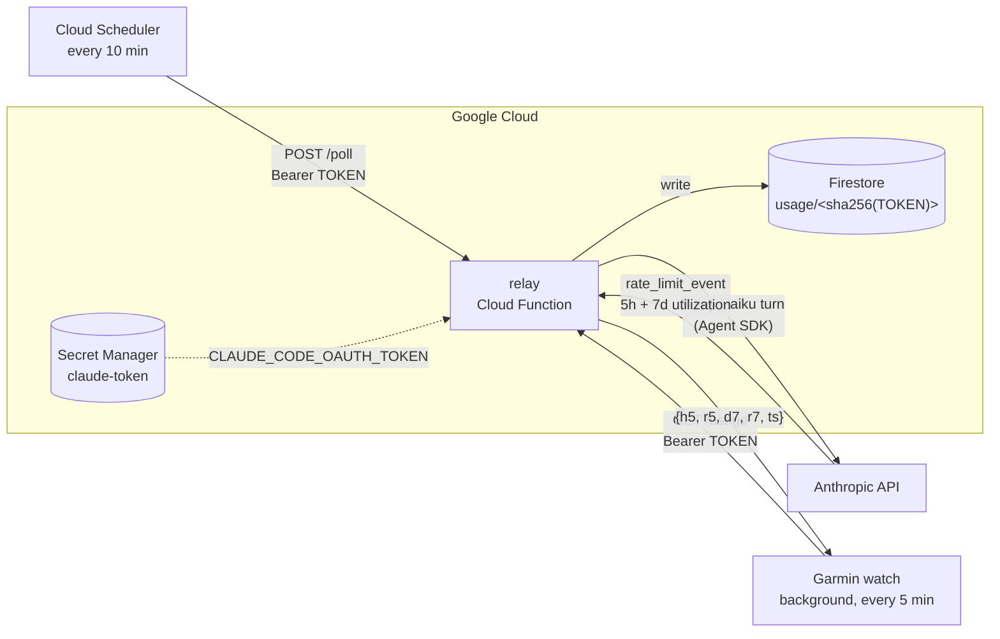

# Token Glance

A Garmin glance that shows how much of your Claude subscription limits you have
used: the 5-hour and 7-day percentage, time until reset, and a pace tick that
tells you whether you are burning faster than the window allows.

Built for a Venu 4 (41 mm and 45 mm), sideloaded, for personal use.

```
 Claude                    7d 78%
 42%   2h 10m
 ━━━━━━━━━━━━│───────────────────     5h bar, │ = pace
 ━━━━━━━━━━━━━━━━━━━━━━━━│───────     7d bar
```

## How it works



1. Cloud Scheduler calls the relay's `/poll` every 10 minutes.
2. The relay runs one minimal Claude Code turn with your `claude setup-token`
   token. The response stream includes a `rate_limit_event` carrying your
   account-wide 5-hour and 7-day usage. It stores the numbers in Firestore.
3. The watch fetches `/usage` in the background every 5 minutes (through the
   phone's Garmin Connect app) and draws the glance from the stored snapshot.
   Countdowns and the pace tick are computed on the watch, so they stay right
   between fetches.

The limits are account-wide, so it covers the desktop app, the CLI and
claude.ai. Nothing runs on your computer. Each poll costs under 1,000 Haiku
tokens against your own limits.

Caveat: `rate_limit_event` is not a documented API. If a Claude Code update
drops it, `/poll` returns 500 and the watch keeps showing the last data.

## Layout

| Path | What |
|---|---|
| `relay/` | Cloud Function (`index.js`, ~70 lines) and `deploy.sh` |
| `watch/` | Connect IQ app in Monkey C (glance, detail page, background fetch) |
| `env.example` | Template for `~/.claude/token-glance/env`, which holds all secrets |
| `SPEC.md` | Design notes and decisions |
| `instructions.md` | Step-by-step setup, written for you or a coding agent |

## Setup

See [instructions.md](instructions.md). It covers the Google Cloud project,
the Claude token, deploying the relay, the scheduler, building the watch app
and sideloading it. You can hand it to a coding agent (Claude Code or
similar) and have it walk you through.

## Installing on your watch (sideload)

This is a personal build, not a Connect IQ Store app. Settings in Garmin
Connect are not available for sideloaded apps, so the relay host and token are
compiled in from `watch/resources/properties/properties.xml` (gitignored).

1. Build: `./watch/build.sh` produces `watch/bin/claude-usage-venu441mm.prg`
   and `claude-usage-venu445mm.prg`. Pick the one for your watch size.
2. Connect the watch to your computer with its USB cable.
   - macOS: Garmin watches use MTP, so they do not show up in Finder. Use
     [OpenMTP](https://openmtp.ganeshrvel.com/) (free) to browse the watch.
   - Windows/Linux: the watch appears as a media device in the file manager.
3. Copy the `.prg` into the `GARMIN/APPS/` folder on the watch.
4. Unplug. The app appears under apps; add **Claude Usage** to your glance
   loop from the watch's glance settings.
5. Give it a few minutes: the first background fetch runs within 5 minutes of
   the app first starting, and needs the phone with Garmin Connect nearby.

To update, copy the new `.prg` over the old one. To remove, delete it from
`GARMIN/APPS/`.

## Security

- No secrets are in this repository. They live in
  `~/.claude/token-glance/env` (mode 600), in Secret Manager, and in your
  local, gitignored `properties.xml`.
- The relay token is only ever sent in the `Authorization` header, never in a
  URL, because Cloud Run access logs record full URLs.
- The Claude token is valid for one year. Revoke it at
  claude.ai/settings/claude-code if it leaks.
- Your Connect IQ `developer_key` signs your builds. Keep it out of git.
